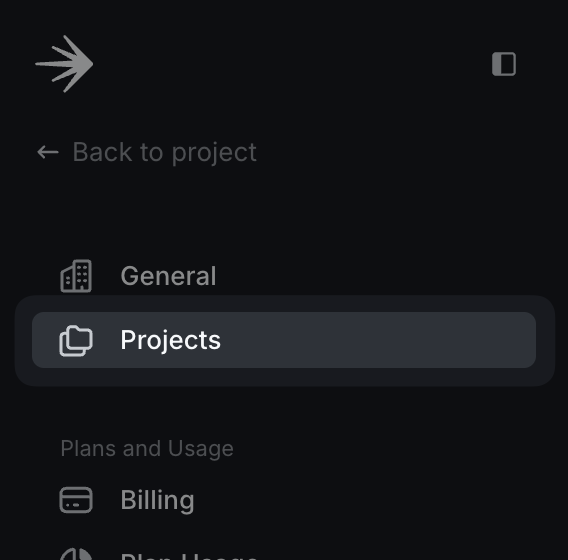
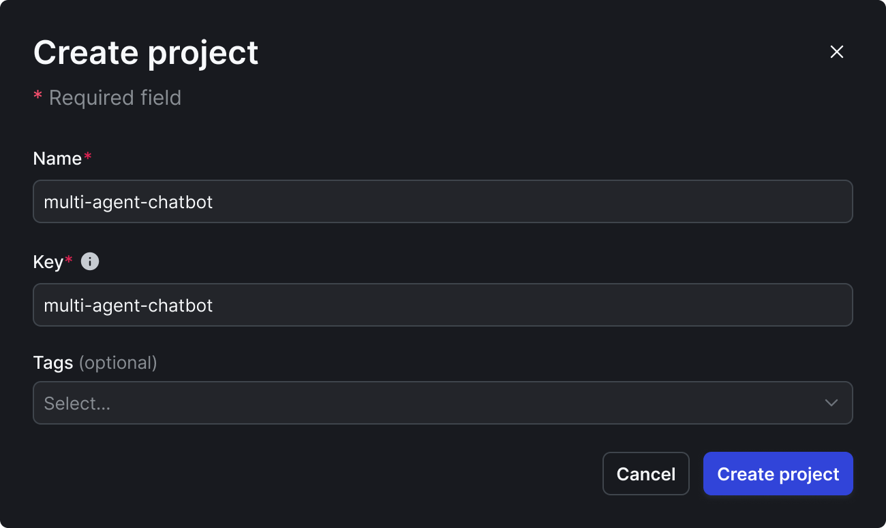
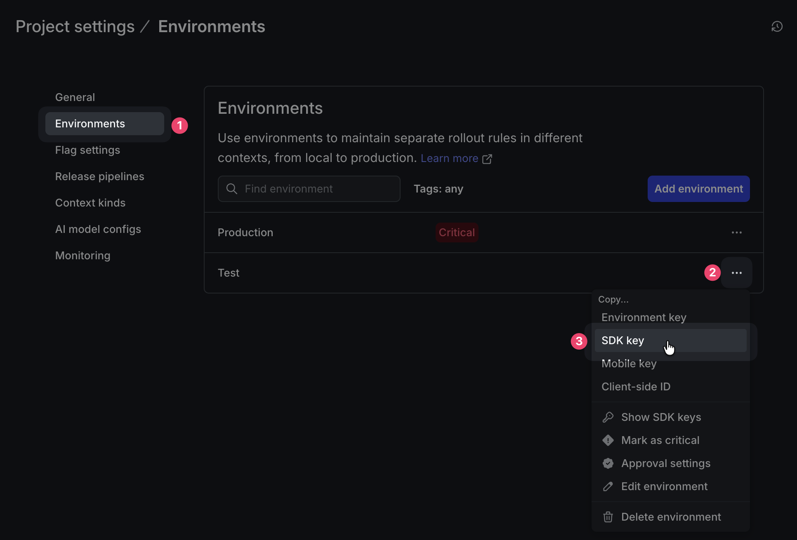
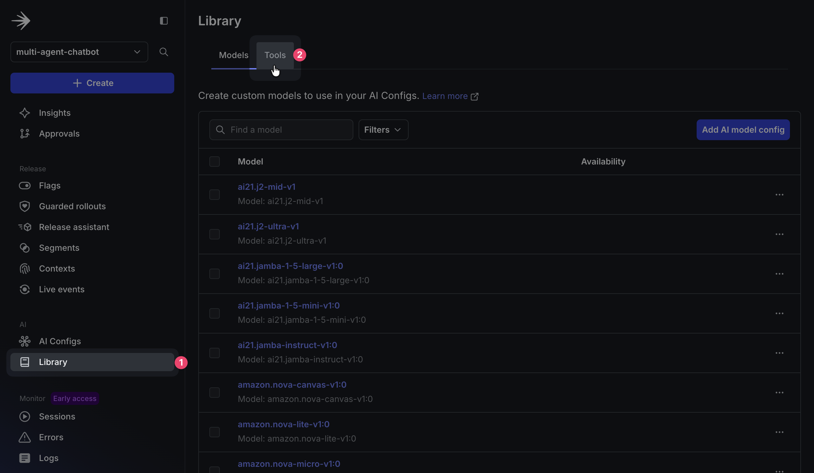
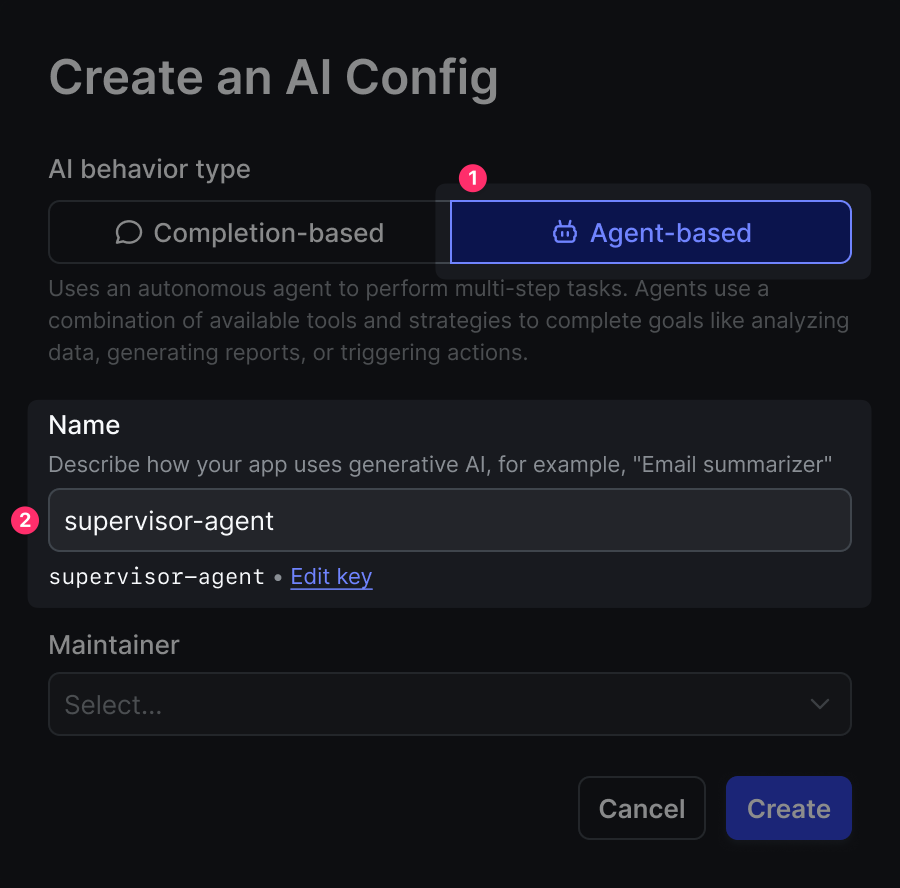
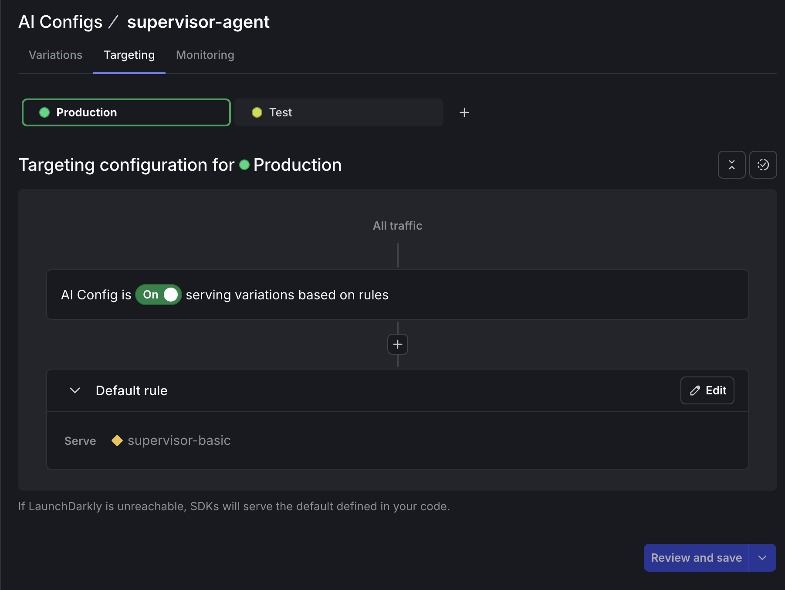
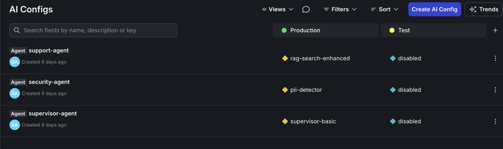
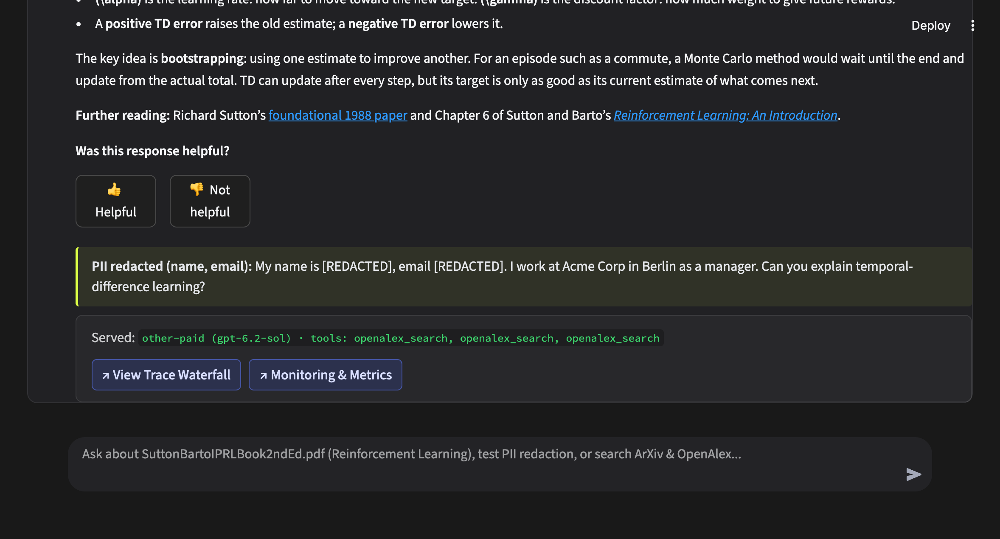

{/* cSpell:ignore devrel Barto rerank IPRL */}
<p class="publishedDate"><em>Published September 8th, 2025</em></p>
<div class="authorWrapper">
  </img>
  <p class="authorName">by Scarlett Attensil</p>
</div>

<Callout intent="info" title="Published September 2025: newer AgentControl features available">

This tutorial was published in September 2025, before LaunchDarkly shipped several features that supersede or complement the patterns shown below. The walkthrough still works, but for new builds you'll likely want to use:

- [**Agent graphs**](/home/agentcontrol/agent-graphs): externalize the multi-agent topology into a visual graph with per-node monitoring (the newer take on this tutorial's pattern)
- [**Online evaluations**](/home/agentcontrol/online-evaluations) and [**custom judges**](/home/agentcontrol/judges): built-in and user-defined LLM-as-a-judge scoring on live traffic
- [**LLM Playground**](/home/agentcontrol/playground): compare variations side-by-side before promoting
- [**Offline evaluations + datasets**](/home/agentcontrol/offline-evaluations): regression-test variations against a saved reference set

AI Configs is now **AgentControl**. Config keys, SDK names, and APIs are unchanged. For the current reference, see [AgentControl documentation](/home/agentcontrol).

</Callout>

## Overview

Build a working multi-agent system with dynamic configuration in 20 minutes using LangGraph multi-agent workflows, RAG search, and LaunchDarkly AgentControl.

*Part 1 of 3 of the series: **Chaos to Clarity: Defensible AI Systems That Deliver on Your Goals***

You've been there: your AI chatbot works great in testing, then production hits and frontier model costs spiral out of control. You switch to Claude, but now European users need different privacy rules. Every change means another deploy, more testing, and crossed fingers that nothing breaks.

The teams shipping faster? They control AI behavior dynamically instead of hardcoding everything.

This series shows you how to build **LangGraph multi-agent workflows** that get their intelligence from **RAG** search through your business documents. These workflows are enhanced with **MCP tools** for live external data and controlled through **LaunchDarkly AgentControl**, all without needing to deploy code changes.

## What This Series Covers

- **Part 1** (this post): Build a working multi-agent system with dynamic configuration in 20 minutes
- **Part 2**: Add advanced features like segment targeting, MCP tool integration, and cost optimization
- **Part 3**: Run production A/B experiments to prove what actually works

By the end, you'll have a system that measures its own performance and adapts based on user data instead of guesswork.

## What You'll Build Today

In the next 20 minutes, you'll have a LangGraph multi-agent system with:

- **Supervisor Agent**: Orchestrates workflow between specialized agents
- **Security Agent**: Detects PII and sensitive information
- **Support Agent**: Answers questions using your business documents
- **Dynamic Control**: Change models, tools, and behavior through LaunchDarkly without code changes

## Prerequisites

You'll need:

- **Python 3.12+** with `uv` package manager ([install uv](https://docs.astral.sh/uv/getting-started/installation/))
- **LaunchDarkly account** ([sign up for free](https://app.launchdarkly.com/signup))

**Choose your AI provider setup:**

**Option A: AWS Bedrock (Recommended)**
- **AWS Account** with Bedrock access and SSO configured
- **No API keys required** - uses AWS SSO authentication
- **Cost-effective** - enterprise-grade with cross-region failover

**Option B: Direct API Keys (Traditional)**
- **OpenAI account & API key** ([sign up / create key at platform.openai.com/api-keys](https://platform.openai.com/api-keys)): required for RAG vector embeddings and Step 8's GPT model switch
- **Anthropic account & API key** ([sign up / create key at console.anthropic.com/settings/keys](https://console.anthropic.com/settings/keys)): required for the Claude agents in Step 5

## Step 1: Clone and Configure (2 minutes)

First, let's get everything running locally. We'll explain what each piece does as we build.

```bash
# Get the code
git clone https://github.com/launchdarkly-labs/devrel-agents-tutorial
cd devrel-agents-tutorial

# Install dependencies (LangGraph, LaunchDarkly SDK, etc.)
uv sync

# Configure your environment
cp .env.example .env
```

First, you need to get your LaunchDarkly SDK key by creating a project:

1. **Sign up for LaunchDarkly** at [app.launchdarkly.com](https://app.launchdarkly.com) (free account).
<Note>If you're a brand new user, after signing up for an account, you'll need to verify your email address. You can skip through the new user onboarding flow after that. </Note>
2. **Find projects on the side bar:**

<br />

<div align="center">

<Frame caption="Projects sidebar in the LaunchDarkly app UI.">

</Frame>

</div>

3. **Create a new project** called "multi-agent-chatbot"

🎯 **Use exact names for Part 2 compatibility**:
- Project: `multi-agent-chatbot`
- AgentControl configs: `supervisor-agent`, `security-agent`, `support-agent`
- Tools: `search_v2`, `reranking`
- Variations: `supervisor-basic`, `pii-detector`, `rag-search-enhanced`

<div align="center">

<Frame caption="Creating a new project in LaunchDarkly.">

</Frame>

</div>

4. **Get your SDK key**:

    ⚙️ (bottom of sidebar) → **Projects** → **multi-agent-chatbot** → ⚙️ (to the right)

    → **Environments** → **Production** → **SDK key**

    this is your `LD_SDK_KEY`

<br />

<div align="center">

<Frame caption="Location of the SDK key in LaunchDarkly project settings.">

</Frame>

</div>

Now configure your authentication method in `.env`:

### Option A: AWS Bedrock Setup (Recommended)

```bash
# LaunchDarkly Configuration
LD_SDK_KEY=your-launchdarkly-sdk-key  # From step above
LD_PROJECT_KEY=multi-agent-chatbot    # Used for LaunchDarkly Trace & Monitoring deep links

# AWS Bedrock Configuration
AUTH_METHOD=sso                       # Use AWS SSO authentication
AWS_REGION=us-east-1                  # Your AWS region
AWS_PROFILE=your-sso-profile-name     # Your AWS SSO profile name

# Optional: Bedrock Embedding Configuration
BEDROCK_EMBEDDING_DIMENSIONS=1024     # Options: 256, 512, 1024
BEDROCK_EMBEDDING_MODEL=amazon.titan-embed-text-v2:0
```

**Then configure AWS SSO:**
```bash
# Configure AWS SSO (one-time setup)
aws configure sso --profile your-sso-profile-name

# Login to AWS SSO (run when token expires)
aws sso login --profile your-sso-profile-name

# Test your access
aws bedrock list-foundation-models --region us-east-1 --profile your-sso-profile-name
```

### Option B: Direct API Keys Setup

```bash
# LaunchDarkly Configuration
LD_SDK_KEY=your-launchdarkly-sdk-key  # From step above
LD_PROJECT_KEY=multi-agent-chatbot    # Used for LaunchDarkly Trace & Monitoring deep links

# Direct API Configuration
AUTH_METHOD=api-key                   # Use direct API keys (default)
OPENAI_API_KEY=your-openai-key        # Required for RAG embeddings
ANTHROPIC_API_KEY=your-anthropic-key  # Required for Claude models
```

This sets up a **LangGraph** application that uses LaunchDarkly to control AI behavior. Think of it like swapping actors, directors, even props mid-performance without stopping the show.

**Security Note:** Do not check the `.env` into your source control. Keep those secrets safe!

### 🚨 **Common AWS SSO Issue:**

If you get `AccessDeniedException` errors, verify your Python code is using the correct AWS profile:

```bash
# Check which AWS account your profile uses
aws sts get-caller-identity --profile your-sso-profile-name

# If the account numbers don't match your error message, add AWS_PROFILE to your .env
```

**The error message will show the account number your Python code is using.** Make sure it matches your SSO profile account.

### 🚨 **Bedrock Model ID Requirements:**

With `AUTH_METHOD=sso`, every Claude model goes through Bedrock, which needs **inference profile IDs** (with region prefix). You can keep picking **Anthropic → claude-haiku-5-5** in the steps below; the app converts it for you.

**✅ BEST PRACTICE - Inference Profile IDs (pick the Bedrock provider in LaunchDarkly):**
```
us.anthropic.claude-haiku-5-5
eu.anthropic.claude-sonnet-5-5
global.anthropic.claude-opus-5-5
```

**⚠️ AUTO-CORRECTED - Anthropic and direct Bedrock model IDs (will be fixed automatically):**
```
claude-haiku-5-5              → us.anthropic.claude-haiku-5-5
anthropic.claude-sonnet-5-5   → us.anthropic.claude-sonnet-5-5
```

**How Auto-Correction Works:**

The system automatically converts Anthropic model names and direct model IDs to inference profile IDs to prevent `ValidationException` errors from Bedrock. The region prefix is determined by:

1. **`BEDROCK_INFERENCE_REGION`** env var (if set) - explicit user preference
2. **`AWS_REGION`** env var (e.g., `us-east-1` → `us` prefix) - automatic detection
3. **Default to `us`** if neither is set

**Configuring Region Prefix:**

To use European inference profiles, add to your `.env`:
```bash
BEDROCK_INFERENCE_REGION=eu  # Force EU inference profiles
```

**Finding Available Inference Profiles:**
```bash
# List available Bedrock inference profiles
aws bedrock list-inference-profiles --region us-east-1 --profile your-sso-profile-name
```

**Why Inference Profiles?**

Bedrock requires inference profile IDs for on-demand throughput. The region prefix (`us.`, `eu.`, `global.`, etc.) enables cross-region inference profiles for better availability and failover.

## Step 2: Add Your Business Knowledge (2 minutes)

The system includes a sample reinforcement learning textbook. Replace it with your own documents for your specific domain.

```bash
# Option A: Use the sample (AI/ML knowledge)
# Already included: kb/SuttonBarto-IPRL-Book2ndEd.pdf

# Option B: Add your documents
rm kb/*.pdf  # Clear sample
cp /path/to/your-docs/*.pdf kb/
```

Document types that work well:
- **Legal**: Contracts, case law, compliance guidelines
- **Healthcare**: Protocols, research papers, care guidelines
- **SaaS**: API docs, user guides, troubleshooting manuals
- **E-commerce**: Product catalogs, policies, FAQs

These documents will serve as the knowledge base for your RAG search, providing business-specific context to your agents.

## Step 3: Initialize Your Knowledge Base (2 minutes)

Turn your documents into searchable **RAG** knowledge:

```bash
# Create vector embeddings for semantic search
uv run python initialize_embeddings.py --force
```

This builds your **RAG** (Retrieval-Augmented Generation) foundation using **OpenAI's** text-embedding model and FAISS vector database. **RAG** converts documents into vector embeddings that capture semantic meaning rather than just keywords, making search actually understand context.

## Step 4: Define Your Tools (3 minutes)

Define the search tools your agents will use.

In the LaunchDarkly app sidebar, click **Agents**, then **Library**. On the following screen, click the **Tools** tab, then **Create tool**.

<br />

<div align="center">

<Frame caption="Library in the AgentControl menu.">

</Frame>

</div>

### Create the RAG vector search tool:
Note: Part 2 creates a simple keyword search tool, search_v1, for free users.
Create a tool using the following configuration:
> 
> **Key:** 
> ```
> search_v2
> ```
>
> **Description:** 
> ```
> Semantic search using vector embeddings
> ```
>
> **Schema:**
> ```json
> {
>   "properties": {
>     "query": {
>       "description": "Search query for semantic matching",
>       "type": "string"
>     },
>     "top_k": {
>       "description": "Number of results to return",
>       "type": "number"
>     }
>   },
>   "additionalProperties": false,
>   "required": [
>     "query"
>   ]
> }
> ```
When you're done, click **Save**.

### Create the reranking tool:
Back on the Tools section, click **Add tool** to create a new tool. Add the following properties: 
> 
> **Key:** 
> ```
> reranking
> ```
>
> **Description:** 
> ```
> Reorders results by relevance using BM25 algorithm
> ```
>
> **Schema:**
> ```json
> {
>   "properties": {
>     "query": {
>       "description": "Original query for scoring",
>       "type": "string"
>     },
>     "results": {
>       "description": "Results to rerank",
>       "type": "array"
>     }
>   },
>   "additionalProperties": false,
>   "required": [
>     "query",
>     "results"
>   ]
> }
> ```
When you're done, click **Save**.
The `reranking` tool takes search results from `search_v2` and reorders them using the BM25 algorithm to improve relevance. This hybrid approach combines semantic search (vector embeddings) with lexical matching (keyword-based scoring), making it especially useful for technical terms, product names, and error codes where exact term matching matters more than conceptual similarity.


> **🔍 How Your RAG Architecture Works**
>
> Your **RAG** system works in two stages: `search_v2` performs semantic similarity search using FAISS by converting queries into the same vector space as your documents (via **OpenAI** embeddings), while `reranking` reorders results for maximum relevance. This **RAG** approach significantly outperforms keyword search by understanding context, so asking "My app is broken" can find troubleshooting guides that mention "application errors" or "system failures."

## Step 5: Create Your AI Agents in LaunchDarkly (5 minutes)

Now that you've created the tools your agents will use, it's time to configure the agents themselves. Each agent will have its own AgentControl config that defines its behavior, model selection, and specific instructions.

Create LaunchDarkly AgentControl configs to control your **LangGraph** multi-agent system dynamically. **LangGraph** is LangChain's framework for building stateful, multi-**agent** applications that maintain conversation state across **agent** interactions. Your **LangGraph** architecture enables sophisticated workflows where **agents** collaborate and pass context between each other.

### Create the Supervisor Agent

1. In the LaunchDarkly sidebar, click **Agents**, then **Configs**, then **Create config**
2. Select **Agent**

<br />

<div align="center">

<Frame caption="Selecting Agent mode.">

</Frame>

</div>

3. Name your config `supervisor-agent`. This will be the key you reference in your code.
4. Configure the following fields in the config form:

> 
> **variation:** 
> ```
> supervisor-basic
> ```
>
> **Model configuration:** 
> ```
> Anthropic
> ``` 
> ```
> claude-haiku-5-5
> ```
>
> **Goal or task:** 
> ```
>   You are an intelligent routing supervisor for a multi-agent system. Your primary job is to assess whether user input likely contains PII (personally identifiable information) to determine the most efficient processing route.
>   PII Assessment:
>   
>   Analyze the user input and provide:
>   - likely_contains_pii: boolean assessment
>   - confidence: confidence score (0.0 to 1.0)
>   - reasoning: clear explanation of your decision
>   - recommended_route: either 'security_agent' or 'support_agent'
>   
>   Route to SECURITY_AGENT** if the text likely contains:
>   - Email addresses, phone numbers, addresses
>   - Names (first/last names, usernames)
>   - Financial information (credit cards, SSNs, account numbers)
>   - Sensitive personal data
>   
>   Route to SUPPORT_AGENT** if the text appears to be:
>   - General questions without personal details
>   - Technical queries
>   - Search requests
>   - Educational content requests
>   
>   Analyze this user input and recommend the optimal route:
>    ```

Click **Review and save**. Now enable your config by switching to the **Targeting** tab and editing the default rule to serve the variation you just created:

<br />

<div align="center">

<Frame caption="Targeting tab showing the default rule configuration for AI agents.">

</Frame>

</div>

Click **Edit** on the Default rule, change it to serve your `supervisor-basic` variation, and save with a note like "Enabling new agent config". Then type "Production" to confirm.
The supervisor **agent** demonstrates **LangGraph** orchestration by routing requests based on content analysis rather than rigid rules. **LangGraph** enables this **agent** to maintain conversation context and make intelligent routing decisions that adapt to user needs and AgentControl config parameters.


### Create the Security Agent

Similarly, create another config called `security-agent`

> 
> **variation:** 
> ```
> pii-detector
> ```
>
> **Model configuration:** 
> ```
> Anthropic
> ``` 
> ```
> claude-haiku-5-5
> ```
>
> **Goal or task:** 
> ```
>You are a privacy agent that REMOVES PII and formats the input for another process. Analyze the input text and identify any personally identifiable information including: Email addresses, Phone numbers, Social Security Numbers, Names (first, last, full names), Physical addresses, Credit card numbers, Driver's license numbers, Any other sensitive personal data. Respond with: detected: true if any PII was found, false otherwise,types: array of PII types found (e.g., ['email', 'name', 'phone']), redacted: the input text with PII replaced by [REDACTED], keeping the text readable and natural. Examples: Input: 'My email is john@company.com and I need help', Output: detected=true, types=['email'], redacted='My email is [REDACTED] and I need help'. Input: 'I need help with my account',Output: detected=false, types=[], redacted='I need help with my account'. Input: 'My name is Sarah Johnson and my phone is 555-1234', Output: detected=true, types=['name', 'phone'], redacted='My name is [REDACTED] and my phone is [REDACTED]'. Be thorough in your analysis and err on the side of caution when identifying potential PII. ```

This agent detects PII and provides detailed redaction information, showing exactly what sensitive data was found and how it would be handled for compliance and transparency.

**Remember to switch to the Targeting tab and enable this agent the same way we did for the supervisor - edit the default rule to serve your `pii-detector` variation and save it.**

### Create the Support Agent

Finally, create `support-agent`


> 
> **variation:** 
> ```
> rag-search-enhanced
> ```
>
> **Model configuration:** 
> ```
> Anthropic
> ``` 
> ```
> claude-haiku-5-5
> ```
>
> → **Add parameters**
> → **Click Custom parameters**
> ```json
> {"max_tool_calls":5}
> ```
>
> Click **Attach tools**.
> 
> select:  **✅ reranking** **✅ search_v2**
>
> **Goal or task:** 
> ```
> You are a helpful assistant that can search documentation and research papers. When search results are available, prioritize information from those results over your general knowledge to provide the most accurate and up-to-date responses. Use available tools to search the knowledge base and external research databases to answer questions accurately and comprehensively.
> ```

This **agent** combines **LangGraph** workflow management with your **RAG** tools. **LangGraph** enables the **agent** to chain multiple tool calls together: first using **RAG** for document retrieval, then semantic reranking, all while maintaining conversation state and handling error recovery gracefully.

**Remember to switch to the Targeting tab and enable this agent the same way - edit the default rule to serve your `rag-search-enhanced` variation and save it.**

When you are done, you should have three enabled agent configs as shown below.

<br />

<div align="center">

<Frame caption="Overview of all three configured AI agents in LaunchDarkly.">

</Frame>

</div>

## Step 6: Launch Your System (2 minutes)

Start the system:

```bash
# Terminal 1: Start the backend
uv run uvicorn api.main:app --reload --port 8000
```

```bash
# Terminal 2: Launch the UI
uv run streamlit run ui/chat_interface.py --server.port 8501
```

Open http://localhost:8501 in your browser. You should see a clean chat interface.

> **Note:** If prompted for authentication, you can leave the email field blank and simply click "Continue" to proceed to the chat interface.

## Step 7: Test Your Multi-Agent System (2 minutes)

Test with these queries:

**Basic Knowledge Test:**
"What is reinforcement learning?" (if using sample docs)
Or ask about your specific domain: "What's our refund policy?"

**PII Detection Test:**
Click **Security Check**, or paste:

"My name is Jane Doe, email jane.doe@example.com. I work at Acme Corp in Berlin as a manager. Can you explain temporal-difference learning?"

That message is two checks in one. The name and email are direct identifiers, so every variation redacts them. The employer, city, and job title are the borderline case: the default variation leaves them, and EU strict security redacts them. The banner under the answer shows the redacted text, so you can see which policy ran. **Basic Search** is the same kind of question with no personal details, and it should not be redacted.

Below every response, the observability bar shows:
- Which variation, model, and tools served your request
- An inline **PII redacted** banner whenever the security agent sanitized sensitive text
- **`↗ View Trace Waterfall`**: opens the exact OpenTelemetry trace in LaunchDarkly (`launchdarkly-ai-server[otel]` exports agent and tool spans automatically using your `LD_SDK_KEY`, with no extra keys or collector)
- **`↗ Monitoring & Metrics`**: opens `support-agent`'s Monitoring tab for token usage, latency, and error rates

<br />

<div align="center">

<Frame caption="Chat interface showing the multi-agent workflow in action.">

</Frame>

</div>

Watch LangGraph in action: the supervisor agent first routes to the security agent, which detects PII. It then passes control to the support agent, which uses your RAG system for document search. LangGraph maintains state across this multi-agent workflow so that context flows seamlessly between agents.

## Step 8: Try New Features

Experience the power of dynamic configuration by making real-time changes to your agents without touching any code:

### Feature 1: Switch Models Instantly

1. In the LaunchDarkly sidebar, click **Agents**, then **Configs**
2. Click on `support-agent`
3. In the **Model configuration** section, change from:
   - **Current:** Anthropic → claude-haiku-5-5
   - **New:** OpenAI → gpt-6.1-terra
4. Click **Save changes**
5. Return to your chat interface at http://localhost:8501
6. Ask the same question again. You'll see the response now comes from GPT-6.1 Terra
7. **What you'll notice:** Different response style, potentially different tool usage patterns, and `gpt-6.1-terra` shown in the served bar and in the LaunchDarkly trace waterfall

### Feature 2: Adjust Tool Usage

Limit how many times your agent can call tools in a single interaction:

1. While still in the `support-agent` config
2. Find the **Custom parameters** section
3. Update the JSON from:
   ```json
   {"max_tool_calls": 5}
   ```
   To:
   ```json
   {"max_tool_calls": 2}
   ```
4. Click **Save changes**
5. In your chat, ask a complex question that would normally trigger multiple searches
6. **What you'll notice:** The agent makes at most 2 tool calls. If it tries a third, the run stops and the reply starts with "I've reached the tool call limit for this request." The server logs show `TOOL CALL #1/2`, `TOOL CALL #2/2`, then `TOOL LIMIT REACHED`

### Feature 3: Change Agent Behavior

Transform your support agent into a research specialist:

1. In the `support-agent` config, locate the **Goal or task** field
2. Replace the existing instructions with:
   ```
   You are a research specialist. Always search multiple times from different angles before answering.
   Prioritize accuracy over speed. For any question, perform at least 2 different searches with varied
   search terms to ensure comprehensive coverage. Cite your sources and explain your search strategy.
   ```
3. Click **Save changes**
4. Test with a question like "What are the best practices for feature flags?"
5. **What you'll notice:** The agent now performs multiple searches, explains its search strategy, and provides more thorough, research-oriented responses

All changes take effect immediately - no deployment, no restart, no downtime. Your users experience the updates in real-time.

## Understanding What You Built

Your **LangGraph** multi-**agent** system with **RAG** includes:

**1. LangGraph Orchestration**
The supervisor **agent** uses **LangGraph** state management to route requests intelligently based on content analysis.

**2. Privacy Protection**
The supervisor **agent** uses **LangGraph** state management to route requests intelligently. This separation allows you to assign a trusted model to the security and supervisor agents and consider on a less-trusted model for the more expensive support agent at a reduced risk of PII exposure.

**3. RAG Knowledge System**
The support **agent** combines **LangGraph** tool chaining with your **RAG** system for semantic document search and reranking.

**4. Runtime Control**
LaunchDarkly controls both **LangGraph** behavior and **RAG** parameters without code changes.

## What's Next?

Your multi-agent system is running with dynamic control and ready for optimization.

 **In Part 2**, we'll add:

- Geographic-based privacy rules (strict for EU, standard for other)
- MCP tools for external data
- Business tier configurations (free, paid)
- Cost optimization strategies

**In Part 3**, we'll run A/B experiments to prove which configurations actually work best with real data.

## Try This Now

{/* Before moving to Part 2, */} Experiment with:

1. **Different Instructions**: Make agents more helpful, more cautious, or more thorough
2. **Tool Combinations**: Add/remove tools to see impact on quality
3. **Model Comparisons**: Try different models for different agents. Keep the supervisor and security agents on a model that supports structured output, such as `claude-haiku-5-5`, a GPT model, or Mistral. Other Claude 5.5 models don't, so the security agent fails closed and every message reaches the support agent as `[Message withheld: the security check failed]`
4. **Cost Limits**: Find the sweet spot between quality and cost

Every change is instant, measurable, and reversible.

## Key Takeaways

- Multi-agent systems work best when each agent has a specific role
- Dynamic configuration handles changing requirements better than hardcoding
- LaunchDarkly AgentControl configs control and change AI behavior without requiring deployments
- Start simple and add complexity as you learn what works

Ready for more? [Continue to Part 2: Smart AI Agent Targeting with MCP Tools →](/tutorials/multi-agent-mcp-targeting)

## Related Resources

Explore the **[LaunchDarkly MCP Server](/home/getting-started/mcp)** - enable AI agents to access feature flag configurations, user segments, and experimentation data directly through the Model Context Protocol.

**More from this series and related tutorials:**

- [Beyond n8n for Workflow Automation: Agent Graphs](/tutorials/agent-graphs) - The newer take on this pattern: externalize the topology itself into a visual graph with per-node monitoring
- [Building Framework-Agnostic AI Swarms](/tutorials/ai-orchestrators) - Compare LangGraph against Strands and OpenAI Swarm running the same agent definitions
- [Build AI Configs with Agent Skills](/tutorials/agent-skills-quickstart) - Generate the configs in this tutorial from natural-language prompts
- [Offline Evaluation of RAG-Grounded Answers](/tutorials/offline-evals) - Add regression tests on the RAG outputs from this system
- [Proving ROI with data-driven AI agent experiments](/guides/experimentation/ai-experiments-roi) - Part 3: A/B test the variations you built here

---

*Questions? Issues? Reach out at `aiproduct@launchdarkly.com` or open an issue in the [GitHub repo](https://github.com/launchdarkly-labs/devrel-agents-tutorial).*
